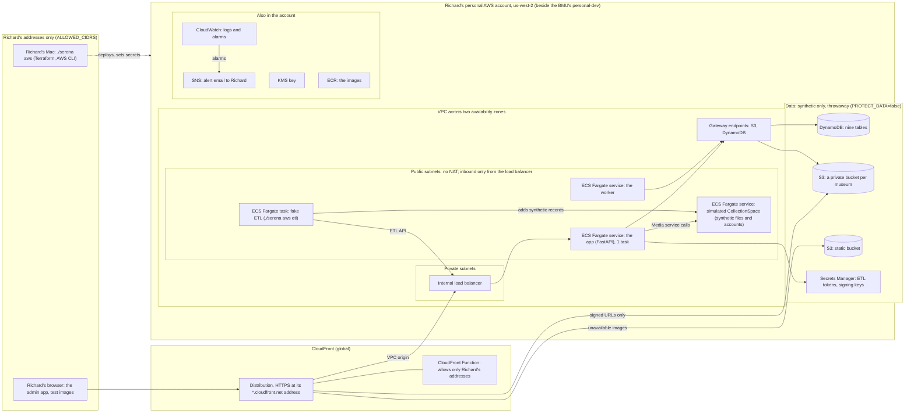
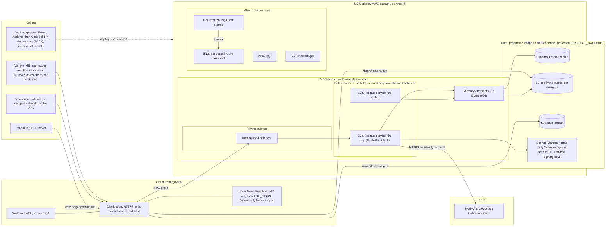

# Serena in AWS

`./serena aws` deploys Serena to an AWS account and looks after it (decisions D181 to D206, October 2026). It is
modeled on the BMU's `./bmu aws`, and the commands are the same where they can be.

- **One environment per settings file** in `deploy/environments/`. `personal-dev.conf` is Richard's personal
  account (us-west-2) and the default. Stage 1 in the UC Berkeley account (CS-9523) has a file too; stage 2 and production keep their settings in
  SSM Parameter Store in their account instead (D273).
- **Infrastructure as code.** Terraform (`deploy/terraform/`) creates everything, so nothing is clicked together in
  the console, and the whole environment can be deleted and created again.
- **No keys or passwords in files.** You sign in with IAM Identity Center (`aws sso login`). Terraform creates
  every secret empty, and `./serena aws` sets them (D191), so no secret is in Terraform's state, a file or the
  shell's history.
- **Who deploys (D268 to D277).** personal-dev and stage 1: `./serena aws` from the deployer's own machine. Stage 2
  and production: only the deploy pipeline (GitHub Actions starts AWS CodeBuild in the account after a reviewer
  approves the plan; not built yet), with `./serena aws` kept for setting secrets and for break-glass. See
  `docs/design.md`, Infrastructure and operations › Deploys. CI checks the Terraform code with no AWS sign-in.

What it builds: the app and the worker on ECS Fargate, CloudFront (HTTPS, the address rules, WAF where it's on) in
front of an internal load balancer, the tables, a bucket per museum, the KMS key, the secrets and the logs (pull
request 17); image delivery from the museums' buckets with signed URLs, the unavailable images, and the alert email
and alarms (pull request 18). The simulated CollectionSpace and the fake ETL, as an option.

## Commands

| Command | What it does |
| --- | --- |
| `./serena aws deploy` | Builds the image (and, with the simulator, the simulator's image) and pushes it, then shows Terraform's plan and, after you type `yes`, applies it and waits until the app and the worker are running. Prints the address and saves it in `deploy/environments/<env>.url`. |
| `./serena aws plan` | Shows what a deploy of the running image would change, without changing anything. |
| `./serena aws status` | The address, the running tasks, the deployed image, the allowed addresses, whether files are delivered (and the trusted signing keys), the alert email and whether it's confirmed, the alarms (and any firing), and each museum with its server and whether each of its secrets is set. |
| `./serena aws url` | Prints the address. |
| `./serena aws logs web` / `worker` / `devtools` | Follows a service's logs, starting with the last 30 minutes. `devtools` (the simulator and the fake ETL) only with the simulator. |
| `./serena aws pause` / `resume` | Stops or starts every service to save money, and switches the alarms' emails off or on (D204). The data stays. Terraform shows the change and asks first. |
| `./serena aws allow-my-ip` | Adds this computer's current address to the allowlist, and applies it. |
| `./serena aws etl <museum> [--rows N] [--failed] [--json]` | With the simulator: runs the fake ETL once, inside the environment, for a whole daily refresh (the same as `./serena etl` on the local stack). Prints the refresh's result and sample image addresses; `--json` prints only its summary, as JSON. `--sizes BAND:COUNT,...` in place of `--rows` gives the records files of about a real file's size, for the replay (D283). |
| `./serena aws replay --log <month>.tsv.gz --busiest hour` | With the simulator only (D279): replays a slice of a cleaned access log against the environment, then prints the web and worker services' CPU and memory from CloudWatch for the run (D278 to D288). `--busiest minute`, or `--from 2026-09-30T19:00 --minutes 60`; `--speed 5` for five times the real rate; `--follow N` to follow one redirect in N; `--first-row N` for new, uncached records (a cold run again). `--dry-run` sends nothing: it prints the slice and the `./serena aws etl … --sizes …` command to run first. See `serenade/README.md`, The access-log replay. |
| `./serena aws test [pytest options]` | The AWS tests (`serenade/aws/`, T90 to T105) against the running environment, after a deploy or resume: about 5 to 10 minutes. Against a real CollectionSpace only the tests that look; set `SERENADE_ADMIN_USER` and it asks for the password. See `serenade/README.md`, The AWS tests. |
| `./serena aws list <museum> [--limit N] [--kind KIND]` | What Serena may serve for the museum, from its servability table (the last updated refresh's servable list): each file's kind, access and Media CSID, with its address. The first 25, or N (`--limit 0` for all); `--kind image` (or `pdf`, `3D` ...) for one kind. Only reads. With the simulator, a deploy or pause empties the simulator but not this table, so a listed file not cached yet can't be fetched until `./serena aws etl` runs again. |
| `./serena aws cspace-secret <museum>` | Sets the museum's read-only CollectionSpace service account. It asks for the user name and password and passes them straight to Secrets Manager. Not with the simulator, whose account deploy sets. |
| `./serena aws etl-token <museum>` | Makes a new random ETL token. The old one becomes "previous" and keeps working until the next rotation. Shows the new token once, for the ETL's token file (Jira CSW-1027). |
| `./serena aws portal-key <museum>` | For a museum with signed access (Cinefiles): makes a new signing key for its signed links, keeping the old one as "previous". Shows the key and its ID once, for the portal (Glimmer). |
| `./serena aws cdn-key` | Makes a new CloudFront signing key for the museums' files (D200): the private key goes straight to Secrets Manager, CloudFront is told to trust the new public key (Terraform shows a small plan), then the app signs with it within 5 minutes. The key before it stays trusted until the next rotation. Nothing is shown. The first deploy makes the first key. |
| `./serena aws confirm-alerts` | Confirms the alert email's subscription (D201): paste the link from AWS's "Subscription Confirmation" email. Don't click the link: confirmed here, unsubscribing needs an AWS sign-in. |
| `./serena aws destroy` | Deletes everything in AWS for the environment, data included. It asks for the environment's name first. |
| `./serena aws init` | Points Terraform at the environment's state, to run `terraform` commands yourself. |

**Picking the environment.** Add `--env NAME`, or set `SERENA_AWS_ENV`. The default is `personal-dev`.
`SERENA_AWS_YES=1` applies without Terraform's `yes` prompt.

**Settings** (in `<env>.conf`, or in the uncommitted `<env>.local.conf`, which wins):

| Setting | What it is |
| --- | --- |
| `AWS_PROFILE`, `AWS_REGION` | The AWS CLI profile (IAM Identity Center) and region. personal-dev uses the BMU's profile: the same account, side by side with the BMU. |
| `SERENA_ENV_NAME` | Resource names (`serena-<name>-…`) and the Terraform state's key. |
| `CSPACE_TENANTS` | The museums and their CollectionSpace servers: `"pahma=https://pahma.qa.collectionspace.org"`. Each needs `backend/serena/museums/<museum>.yaml`. |
| `SIMULATED_CSPACE`, `SIMULATED_MUSEUMS` | `true` runs the simulated CollectionSpace for the museums listed (default `pahma`) instead of `CSPACE_TENANTS`. |
| `ALLOWED_CIDRS` | Addresses that may reach everything. The first deploy adds this computer's; `allow-my-ip` adds more. |
| `ETL_CIDRS`, `ADMIN_CIDRS` | Addresses that may also reach `/etl/` (the ETL servers) and `/admin` (campus networks), D185. |
| `OPEN_IMAGES` | `true` lets anyone request the image paths and `/health` (production). `false` limits them to `ALLOWED_CIDRS`. |
| `WAF` | `true` puts a WAF web ACL on the distribution (D186). Off in personal-dev, which is allowlisted anyway. |
| `PROTECT_DATA` | `true` where the data matters (D192): see "Protecting data". |
| `WEB_COUNT` | Web tasks: 1 in personal-dev, 2 elsewhere (D188). |
| `ENV_LABEL` | Shown in the admin app's header. |
| `ALERT_EMAIL` | Where alerts and alarms are emailed (D201). Only in the uncommitted `.local.conf`, so no address is in the repository: in personal-dev, your own; in QA and production, the team's mailing list. Empty: no email. After the deploy that subscribes it, `./serena aws confirm-alerts`. |

**Once deployed, a museum's server never changes.** A museum's servability, recalls and cached files refer to the
records on the server it was deployed for. So `deploy`, `plan`, `pause`, `resume` and `allow-my-ip` stop before
changing anything if a museum's server changed. Either put the setting back, or `./serena aws destroy` first, or
deploy the new server as another environment (a different `SERENA_ENV_NAME` in your `.local.conf`). Adding a museum
is allowed. Removing one asks you to type its name: its bucket (its cached files) and secrets go with it. Never where
data is protected.

## First deploy (personal-dev, with the simulator)

**What you need on the Mac:** Docker Desktop, running; AWS CLI v2; Terraform 1.10 or later
(`brew tap hashicorp/tap && brew install hashicorp/tap/terraform`); python3.

```bash
aws sso login --profile bmu-personal
./serena aws deploy
./serena aws etl pahma
```

1. **Account check.** The first time, it shows the account the profile is signed in to and asks whether it's the
   right one. It saves the answer in `deploy/environments/personal-dev.local.conf` (not committed) and from then on
   refuses any other account. If the account already has a Serena environment with the same name, it asks whether
   it's yours.
2. **Allowlist.** It adds this computer's public address. Everyone else gets a 403 from CloudFront.
3. **State bucket.** It creates `serena-tfstate-<account>-<region>`, once per account.
4. **Image repositories** (about a minute), then **the images**, built for ARM and pushed: Serena's
   (`deploy/Dockerfile`: the app and the built admin app, D190) and, with the simulator, the local stack's
   (`backend/Dockerfile`), which runs the simulator and the fake ETL. Both take their Python base image from Amazon
   ECR Public; for `backend/Dockerfile` the deploy swaps it in with a named build context, since CI and the local
   stack build that file from Docker Hub (ECR Public refuses GitHub's shared runners).
5. **Serena.** Terraform lists what it will create and asks; type `yes`. The first time takes about **15–25
   minutes**, mostly CloudFront. It finishes when the app and the worker are running.
6. **Secrets.** With the simulator, deploy sets each museum's secrets once: the simulator's synthetic account, a
   random ETL token and, for a museum with signed access, a random portal key. Nothing is shown.
7. **Image delivery.** The first time, it makes the CloudFront signing key (as `./serena aws cdn-key` does): Terraform
   shows a second, smaller plan, which adds the key group and the museums' file paths to the distribution (a few
   minutes). From then on a servable file is delivered with a signed URL.
8. **Alert email.** With `ALERT_EMAIL` set, AWS emails that address a confirmation link. Don't click it: run
   `./serena aws confirm-alerts` and paste it there. The link expires after 3 days.

It prints the address (`https://<something>.cloudfront.net`). The admin app is at `/admin/`: sign in as `admin` /
`admin` (the simulator's synthetic admin, every museum), `pahma-admin` / `pahma-admin`, or `viewer` / `viewer`.

**A daily refresh:** `./serena aws etl pahma` runs the fake ETL as a one-off task inside the VPC. It adds the
day's synthetic Media records to the simulator, then runs the refresh through the ETL API (start, upload, check, poll)
with the museum's ETL token, which it reads from Secrets Manager itself. It takes a minute or two and prints the
refresh's counts. The refresh then shows in the admin app. Run it again with the same `--rows` (the delta threshold
compares with the last one).

**Later deploys.** The same command. Terraform shows only what changed (about 3–5 minutes). Each deploy pushes a new
image tag (commit and time, `-dirty` for uncommitted changes), so `status` shows which code runs.

## Against a real CollectionSpace (QA, then production)

**UC Berkeley data only in a UC Berkeley AWS account.** An environment with a real CollectionSpace, production or QA
(Lyrasis's QA tenants hold a copy of production's database), copies the museums' files into its account. It may run
only in a UC Berkeley AWS account, never in a personal one; a personal account is for the simulator only. Every
`./serena aws deploy` of such an environment shows this rule and goes ahead only once you type the account's number.

With `SIMULATED_CSPACE=false` and `CSPACE_TENANTS` set, after the first deploy:

1. `./serena aws cspace-secret <museum>` for each museum: its read-only service account.
2. `./serena aws etl-token <museum>`: give the token to whoever runs the ETL, for its token file (CSW-1027). Allow
   the ETL server's addresses with `ETL_CIDRS`.
3. `./serena aws portal-key cinefiles`, once Cinefiles is served: give the key ID and key to Glimmer.

`status` says "NOT SET" for any secret still empty. A token or key rotation keeps the previous one working until
the next rotation, so the ETL or the portal can switch at its own pace.

## The simulated CollectionSpace and the fake ETL (D189)

- **The simulator** runs as its own service, reachable only by the app, the worker and the fake ETL, at
  `http://fakecspace.serena-<env>.internal:8180` (a private DNS name). Each museum's server is that address with
  the museum's name after it (`…:8180/pahma`); the simulator tells the museums apart by that path.
- **Its data is in memory.** A pause, a deploy or a restart starts it empty, while Serena keeps its tables and
  files. `./serena aws etl` adds the records it lists every time, so a refresh after a restart works.
- **The fake ETL** refuses to run unless the environment runs the simulator (`SERENA_SIMULATED_CSPACE=true`, set
  only there) and every museum's server is the simulator, so it can never send a servable list to a museum with
  real data.
- Never with `PROTECT_DATA=true`.

## Diagrams

The same Terraform (`deploy/terraform/personal/`, with the shared modules in `deploy/terraform/modules/`; D302)
builds every personal environment and stage 1; the settings file decides which parts exist
and who can reach them. These two diagrams show the two kinds of environment, read from that Terraform. The table
after them lists every difference.

### personal-dev: Richard's personal AWS account

The simulated CollectionSpace and the fake ETL, synthetic data only, reachable only from Richard's addresses. Each
developer's own environment in their own account looks the same.



### The UC Berkeley AWS account: pre-production, then production

Stage 2 (pre-production): PAHMA's production CollectionSpace, the production ETL's daily servable list (Jira
CSW-1027), WAF and data protection on, open to campus networks and the VPN until PAHMA's imageserver paths are
routed to it. Stage 1 (CS-9523) comes first in the same account and looks like the personal-dev diagram above:
the simulator and the fake ETL, open to campus networks and the VPN, destroyed when it passes
(`docs/testing-checklist.md`, section 31).



In both, the app's signed URLs send a visitor's browser to `/<museum>/objects/*` on the same distribution, which
reads the museum's bucket directly, and the worker never calls CollectionSpace. The Terraform state bucket
(`serena-tfstate-<account>-<region>`) is left out: `./serena aws` creates it once per account.

### What differs between environments

The same Terraform builds every environment; only its settings differ.

| | personal-dev | UC Berkeley, stage 1 (CS-9523) | UC Berkeley, stage 2: pre-production |
| --- | --- | --- | --- |
| AWS account | Richard's personal account, beside the BMU's personal-dev | UC Berkeley test account | To decide: production, or another account not shared with test workloads |
| CollectionSpace | The simulator (`SIMULATED_CSPACE=true`) | The simulator | PAHMA's production tenant, read-only account (`SIMULATED_CSPACE=false`) |
| ETL | Fake ETL (`./serena aws etl`) | Fake ETL | The production ETL (Jira CSW-1027); no fake ETL |
| WAF (`WAF`) | Off | Off | On |
| Data protection (`PROTECT_DATA`) | Off: throwaway | Off: destroyed when stage 1 passes | On |
| App tasks (`WEB_COUNT`) | 1 | 2 | 2 (D188) |
| Who can reach it | Richard's addresses (`ALLOWED_CIDRS`) | Campus networks and the VPN | Campus networks and the VPN, and the ETL server for `/etl/` (`ETL_CIDRS`); everyone for files once a museum's paths are routed to it (`OPEN_IMAGES=true`) |
| Alerts (`ALERT_EMAIL`) | Richard | Richard | The team's mailing list |
| Settings | `deploy/environments/personal-dev.conf` and `.local.conf` | `deploy/environments/ucb-stage1.conf` and `.local.conf` (`--env ucb-stage1`) | SSM Parameter Store in the account (D273) |
| Deployed by | `./serena aws` from Richard's Mac | `./serena aws`, no pipeline (D269) | The deploy pipeline, after a reviewer approves the plan (D268 to D272); secrets set by an admin with `./serena aws` (D274) |

## What it creates

- **Network (D187).** A VPC across two zones. The tasks run in public subnets with public addresses and no NAT
  gateway; their security groups take traffic only from the load balancer, so nothing can connect in. The
  internal load balancer is in private subnets. Free gateway endpoints for S3 and DynamoDB.
- **CloudFront (D183).** HTTPS at CloudFront's own address, through a VPC origin to the internal load balancer.
  Nothing is cached but the admin app's built files. A CloudFront Function checks the visitor's address (D185):
  `ALLOWED_CIDRS` reach everything, `ETL_CIDRS` `/etl/` too, `ADMIN_CIDRS` `/admin` too, and the rest (the image
  paths, `/health`) is open with `OPEN_IMAGES=true`. A domain later is an alternate name and a certificate on the
  same distribution.
- **WAF (D186), with `WAF=true`.** AWS's common rule set, known bad inputs, the IP reputation list and a rate limit
  per address, with Bot Control in count mode. The common rule set's body-size rule counts instead of blocking, so
  a servable list can be uploaded. Its logs redact the path and the query string.
- **ECS (D188).** The app (1 vCPU, 2 GB, 50 GB of ephemeral storage for fetches) and the worker (0.5 vCPU, 1 GB),
  on ARM, from one image. A deploy replaces the app's tasks one by one, stops the old worker before the new one
  starts, and rolls back if they don't start.
- **Data.** The nine tables (from `deploy/terraform/modules/core/tables.json`, which `backend/serena/tables.py` generates),
  one bucket per museum (versioned, encrypted with the KMS key, Intelligent-Tiering, no rule that deletes), one KMS
  key with yearly rotation, and the secrets: per museum, its CollectionSpace account, its ETL tokens and, with
  signed access, its portal signing key.
- **Image delivery (D195 to D200).** Once the signing key exists, a behavior per museum, `/<museum>/objects/*`, to its
  bucket through origin access control, for a valid signed URL only (the key group trusts the current key and the
  one before it). The allowlist function removes `/<museum>` from the path. Each bucket's policy lets only this
  distribution read, and only `objects/`; the key's policy lets CloudFront decrypt for this distribution only.
  CloudFront caches the files at its edges and adds `Cache-Control: private, max-age=900`. The public keys are in the
  SSM parameter `/serena-<env>/cloudfront-public-keys`, the private key in the secret `serena-<env>/cloudfront-signing-key`.
- **The unavailable images (D199).** A static bucket, `serena-<env>-static-…` (S3-managed encryption), holds each
  museum's `unavailable.svg`, the default one and the generic `placeholder.svg`, uploaded by Terraform from
  `backend/serena/static/`; served without a signature, with a Content-Security-Policy that stops a script.
- **Alerts and alarms (D201 to D204).** The SNS topic `serena-<env>-alerts`, encrypted with the key, with
  `ALERT_EMAIL` subscribed. The worker emails the watchdog's alerts to it. Six alarms email it when they fire and when
  they clear: no healthy app task for 5 minutes; the worker not running for 10 minutes; 5 or more 5xx answers in 5
  minutes; and, from metric filters on the app's log, 5 or more internal errors, any refusal by CollectionSpace (most
  often a changed password), or 20 or more fetches CollectionSpace didn't answer, each in 15 minutes. Paused, they
  send nothing.
- **Logs.** `/serena/<env>/web`, `/worker` (and `/devtools`), kept 30 days, encrypted with the key. The load
  balancer's and CloudFront's access logs are off (design: Infrastructure and operations).
- **IAM.** One role for the app and one for the worker, with only what each needs (`iam.tf` has the table), and one
  for the fake ETL (its museums' ETL tokens only). Whoever deploys also needs SSM Parameter Store (the public keys)
  and SNS, besides what pull request 17 needed.

## Protecting data (D192)

`PROTECT_DATA=true` (QA and production): tables can't be deleted, `destroy` won't empty the buckets, and deleted
secrets and the key wait 30 days. `false` (personal-dev): `destroy` removes everything. Always, whatever the setting:
point-in-time recovery on every table but the admin sessions, bucket versioning, no rule that deletes, key rotation.

## The deployer's permissions

The IAM policies `./serena aws` needs in a UC Berkeley account are in [`iam/`](iam/README.md): stage 1's permission
set (`serena-deployer-policy-mvp.json`) and stage 2's draft (`serena-deployer-policy.json`), with what else Operations
provides (service-linked roles, CloudFront verification on a new account). personal-dev runs as an administrator.

## Terraform

- **Two configurations.** `registry` (the image repositories) and `app` (everything else), applied in turn, with
  the images pushed in between.
- **Versions.** Terraform 1.10 or later (CI uses 1.16.5) and the AWS provider 6.x, pinned by `.terraform.lock.hcl`
  in each folder for Macs and Linux.
- **State** in `s3://serena-tfstate-<account>-<region>/serena/<env>/registry.tfstate` and `personal.tfstate`, versioned
  and private, with a lock file beside it.
- **One account only.** Each configuration refuses any account but the environment's. `./serena aws` ignores
  access keys left in the shell.
- **Running Terraform yourself.** `./serena aws init`, then read-only commands such as
  `AWS_PROFILE=bmu-personal terraform -chdir=deploy/terraform/personal state list`. Use `./serena aws deploy` for changes.

## Checking the Terraform code

CI's `terraform` job runs `terraform fmt -check`, `validate` for both configurations and `terraform test` (a
simulated AWS provider: `deploy/terraform/personal/tests/personal.tftest.hcl`, which reads the modules' resources
through their `test` outputs), with no AWS sign-in.
`backend/tests/test_deploy.py` checks that the tables and the settings Terraform gives the app match the code. On
your computer, use an empty Terraform folder, since one `./serena aws` initialized points at the state in S3:

```bash
(cd deploy/terraform/personal && export TF_DATA_DIR="$(mktemp -d)" &&
  terraform init -backend=false -lockfile=readonly && terraform validate && terraform test)
```

After changing a `.tf` file: `terraform fmt -recursive deploy/terraform`. After changing a table:
`cd backend && python -m serena.tables > ../deploy/terraform/modules/core/tables.json`.

## Cost (personal-dev, rough us-west-2 prices)

| State | Cost | Main items |
| --- | --- | --- |
| Running | About **$2.75 a day** (about $82 a month) | The app's task (about $31 a month, its extra storage included), the worker (about $14), the simulator (about $7), the load balancer (about $16), three public IPv4 addresses (about $11), the KMS key and secrets (about $2), six alarms (about $0.60). CloudFront, DynamoDB, S3, SNS and the logs cost cents at test volumes. |
| Paused | About **$0.60 a day** | The load balancer, the key and the secrets still bill. |
| Destroyed | Nothing | — |

WAF adds about $15 a month plus Bot Control's fee when it's on. Pause or destroy the environment between test sessions.

## Not yet

- **CORS (D205).** Delivered files carry no `Access-Control-Allow-Origin`. If a portal's JavaScript viewer (3D, PDF)
  needs it in QA, it's a small change.
- **A cost alert (D206).** Not in Terraform; cost tracking is for the UC Berkeley account's ops ticket.
- **60-second requests (D184).** CloudFront waits at most 60 seconds for Serena's answer. A first request whose fetch
  takes longer gets a 504; the fetch still finishes and the next request is a hit. AWS raises the limit to 180
  seconds on request: ask before production.
- **No custom domain.**

## If something goes wrong

- **"Not signed in to AWS".** The sign-in (8 hours) expired: `aws sso login --profile <profile>`, then repeat the
  command, which changed nothing.
- **"The new signing key … isn't trusted by CloudFront yet".** The apply after `cdn-key` didn't finish:
  `./serena aws deploy` (or `cdn-key`) again finishes it, without making another key.
- **Alarm emails while you work.** Pausing switches them off. A deploy's restart can fire "web down" or "worker down"
  briefly; they clear on their own and email when they do.
- **"Docker isn't running".** Start Docker Desktop and deploy again.
- **The first creation fails.** Terraform stops at the resource that failed and keeps the rest; `./serena aws
  deploy` again continues. A brand-new account sometimes fails once while AWS creates its service roles, and
  CloudFront may refuse distributions until AWS has verified a new account (AWS Support).
- **403 "open only to listed addresses".** Your address changed: `./serena aws allow-my-ip`.
- **A task doesn't start.** `./serena aws logs web` (or `worker`) and `./serena aws status`. An `AccessDenied` in the
  logs means a permission `iam.tf` lacks: note the action and resource for the fix (and for the ops ticket's policy).
- **`./serena aws etl` fails.** Its output is the fake ETL's log. "is the worker running?" means the refresh waited
  past its timeout: check `./serena aws logs worker`. A delta-threshold failure means the last updated refresh had
  a different `--rows`.
- **`destroy` stops at the VPC.** CloudFront removes its VPC origin's network interfaces in the background: run
  `./serena aws destroy` again a few minutes later.
- **"Error acquiring the state lock".** An earlier run was interrupted. Check nothing else is running, then
  `./serena aws init` and `AWS_PROFILE=<profile> terraform -chdir=deploy/terraform/personal force-unlock <lock ID>`.
