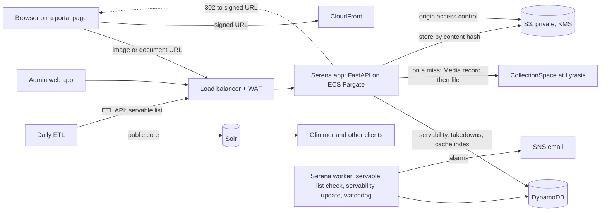
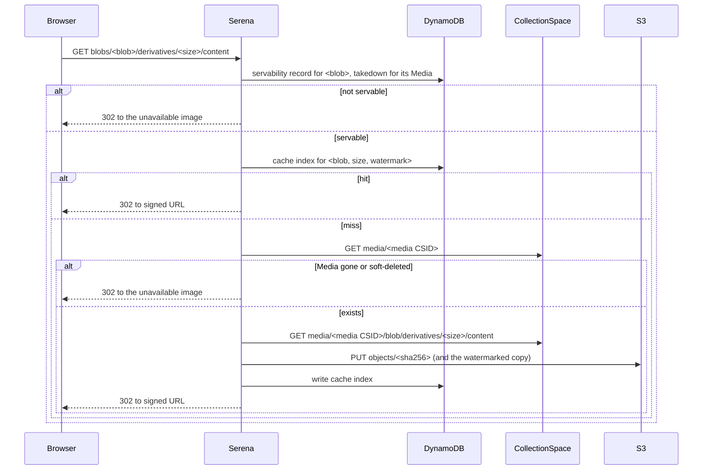

# Serena (the new CollectionSpace media server): Design

Richard Millet · started October 8, 2026 · for later changes see this file's history in git

> This file is the design document, and its only copy. It replaces the earlier proposals kept in Google Drive (see
> "How we got here"). Change it through pull requests, together with the code it describes.

## Summary

Serena serves the images and documents that the UC Berkeley museums' public portals show, at the URLs the legacy
`imageserver` uses today. It decides what it may serve from the daily Solr ETL's output, keeps its own private copy
of every file it has served, and hands browsers short-lived signed links to that copy.

It runs as an AWS service: a FastAPI app on ECS Fargate behind a load balancer, a worker that takes in each day's
servable list, an admin web app, DynamoDB for its records, private S3 buckets for the files and CloudFront for delivery.

Key decisions:

- **Same URLs, keyed by Blob CSID.** Glimmer and any other client keep requesting
  `…/<tenant>/imageserver/blobs/<blob CSID>/derivatives/<size>/content` and `…/blobs/<blob CSID>/content`; nothing
  in Glimmer changes. A URL keyed by Media CSID is added for clients that want it.
- **The ETL decides what is public.** Each day, after it refreshes the public core, the ETL job makes a servable list
  of every Blob in the live public core, with its Media CSID, kind and access, and hands it to Serena. Serena serves a
  Blob only if that list has it as public, in a kind Serena serves, and its Media record has no takedown in Serena.
  Serena never reads Solr or CollectionSpace's Postgres.
- **The ETL and Serena move together.** The ETL job drives Serena's part of each daily refresh through Serena's ETL
  API, after the Solr refresh, so on a good day both describe the same data. If Serena's part fails, the ETL job
  carries on and an admin brings Serena up to date.
- **Checked on every request.** Every request, cache hit or miss, goes through the servability check.
- **All calls to CollectionSpace go through the Media service.** On a cache miss Serena checks that the Media
  record exists and isn't deleted (the light check), then fetches the Media record's current file. It never compares
  Blob CSIDs.
- **Fill on demand, keep forever.** The first request for a file fetches it from CollectionSpace with a read-only
  service account and stores it in Serena's own private, KMS-encrypted S3 bucket, keyed by its content hash. Nothing
  is pre-warmed, and nothing cached is ever deleted: a takedown stops serving it.
- **Signed links.** Serena answers a servable request with a 302 redirect to a CloudFront signed URL, issued in
  15-minute windows and valid for 15 to 30 minutes. Anything it won't serve gets a 302 to the museum's unavailable
  image, never an error.
- **Restricted files only with a portal's signature.** The ETL decides, with each museum's rules, which files are
  restricted; Serena serves a restricted file only with a valid link the portal signed, and only for kinds the museum
  allows (today Cinefiles' PDFs, signed by Glimmer). Decided October 9, 2026.
- **Watermarks are made once.** For a museum that watermarks, Serena makes the watermarked copy the first time it's
  needed, stores it like any other file, and never serves an unwatermarked copy of a size it watermarks.
- **An admin web app from the start.** Museum and team admins see refreshes, alerts and why a file is or isn't served;
  they take files down, change settings and recover from failed refreshes.
- **No personal data in logs.**

## Serena and its clients

Three things are easy to blur, and this design keeps them apart:

| Part | What it is | Reads | Produces |
| --- | --- | --- | --- |
| The ETL (`cspace-solr-ucb`) | A daily job per museum | CollectionSpace's Postgres | The public Solr core, and the servable list for Serena |
| The public core | Data | n/a | What every client of the core sees |
| Glimmer, and other clients | Applications | The public core, live | Requests to Serena's URLs |
| Serena | The media server | The servable list (never Solr) | Images and documents |

Glimmer is the client we know; others may read the public cores, and this design assumes they do. Serena depends
only on the public core, through the servable list, never on Glimmer. Changes on Glimmer's side (new URL
shapes, a move to Media CSIDs) follow Glimmer's own timeline.

Two rules follow (decided October 9, 2026):

- **Each refresh date:** the public core and Serena's records describe the same ETL job, except on a failed refresh (see
  The daily sequence).
- **Each release:** Serena serves every URL shape and kind its clients build.

## Background: the legacy imageserver

The legacy `imageserver` is a Django view in
[cspace-webapps-common](https://github.com/cspace-deployment/cspace-webapps-common) (`imageserver/views.py`),
deployed per museum from [cspace-webapps-ucb](https://github.com/cspace-deployment/cspace-webapps-ucb).

- **Flow.** It fetches the requested file from the museum's CollectionSpace with a service account and returns the
  bytes. Every request goes to CollectionSpace: there is no caching anywhere.
- **Sizes.** A per-museum setting (`derivatives_served`) names the sizes it serves.
- **Watermarks.** A museum can turn on watermarking (today only the Botanical Garden does). The watermark is
  composited with ImageMagick on every request.
- **Failures.** Any error returns the museum's "image unavailable" picture (`404.svg`).

What Serena improves:

- **Speed and cost.** No caching, a new connection and login per request, whole files held in memory, and watermarks
  recomputed on every request. Crawlers walking the catalog make every request a slow trip to CollectionSpace.
  Serena fetches a file once and serves it from S3 through CloudFront.
- **Failures you can see.** Serena logs and counts each cause of a file not being served, and shows them in its admin
  app.

## CollectionSpace and ETL facts this design depends on

| Fact | Consequence for Serena |
| --- | --- |
| A Media record links to at most one Blob through its `blobCsid` field. A Blob has no field pointing back. | Serena needs the ETL to tell it each Blob's Media CSID (Jira CSW-1027). |
| Replacing a Media record's image always creates a new Blob record. The old Blob is left orphaned; CollectionSpace doesn't delete it. | A Blob CSID is never reused for different content. |
| The Media service serves a Media record's current file: `media/<csid>/blob/content` and `media/<csid>/blob/derivatives/<name>/content`. It also returns soft-deleted Media records and their files. | Serena fetches through the Media service, after checking the record isn't deleted. |
| Publication (`approvedforweb` / `postToPublic`), sensitivity (for PAHMA, the related Object's status) and access (for Cinefiles, the document's access code and record status) live on the Media, Object and Organization records, not on the Blob. | Serena doesn't evaluate them. The ETL does, per museum, in `cspace-solr-ucb`, and tells Serena the result (see Restricted files). |
| The public core lists Blob CSIDs in `blob_ss`, `card_ss`, the primary image field, the audio, video and 3D CSID fields, and (Cinefiles) `pdf_ss`. At PAHMA, images that aren't public appear as its restricted-image Blob; the other museums leave them out. Cinefiles documents carry an access code; only code 4 ("World") is public. | The servable list mirrors these fields, with a kind and an access value per Blob. |
| Cinefiles staff set a document's access in CollectionSpace: "Access code override" on the document (Object) record, otherwise "Publication access code" on the Organization record named in its Source field. The values are PFA Staff Only, In House Only, Campus (UCB), Education (\*.edu) and World. A document's Record status must be approved for it to be in the public core. Cinefiles' ETL has no Media-level publish flag: every Media record of an included document is in the public core. | For Cinefiles, the access code restricts a PDF and the record status removes a whole document; unpublishing a Media record changes nothing. |
| Cinefiles' access code is computed into a table (`cinefiles_denorm.doclist_view`, column `code`) by a daily "denorm" job that Lyrasis runs, not RTL; the ETL reads that table. | Restriction for Cinefiles depends on that job having run. The servable list script takes a PDF's access from `code_s` in the public core, so Glimmer and Serena agree. |
| The ETL runs daily, starting at 03:01 for all museums in parallel. It empties each core and reloads it in place (delete, commit, then the day's CSV posted to Solr 8 on the ETL server); if a load fails it posts the previous day's CSV again. There is no staging core. Its output is immutable. | New files appear, and CollectionSpace-driven takedowns take effect, within about 24 hours. |
| CollectionSpace is hosted at Lyrasis. Designs assume only HTTP Basic authentication (newer CollectionSpace versions also have OAuth2, not checked for the hosted version). | Serena uses one read-only service account per museum, password in Secrets Manager. |
| CollectionSpace generates the image derivatives (Thumbnail, Small, Medium, FullHD, OriginalJpeg) itself. | Serena never resizes. It makes only watermarked copies. |
| Most CSIDs are UUIDs, but CollectionSpace doesn't require it: a record created by an import keeps the CSID it was given. PAHMA's restricted-image Blob has the shorter CSID `59a733dd-d641-4e1a-8552`. | Serena doesn't require a CSID to be a UUID (see URLs). |

Museum users' tolerances: up to 24 hours for new content to appear; 1 to 2 hours for a takedown. The 24-hour
takedown window through CollectionSpace is accepted for now (October 8, 2026); the admin app's takedown covers the
urgent case.

## Goals, non-goals and constraints

Goals:

- Serve every URL shape and kind Serena's clients build today, unchanged, for all five museums.
- Serve only what the ETL lists as public and Serena hasn't taken down.
- Make a repeated request cheap: CollectionSpace is normally asked for a given file only once, ever.
- Watermark for any museum that wants it, now or later, at no per-request cost.
- Scale horizontally; keep all state outside the app's tasks, apart from short-lived caches and counts that a task
  can lose without harm (a museum's settings for a minute, unserved-request counts until the next write).
- Show what's happening, to the team and to museum admins: requests, cache hits and misses, files not served and why,
  fetch times and errors, daily refreshes.

Non-goals:

- Deciding what is public. That stays in the ETL.
- Cleaning up orphaned Blobs in CollectionSpace. That belongs to whoever runs CollectionSpace.
- Any change to Lyrasis's buckets or configuration.
- Changes to Glimmer, apart from one: Glimmer signs the links it gives signed-in readers to restricted files (see
  Restricted files).

Constraints (also in `CLAUDE.md`):

- Serena never reads CollectionSpace's Postgres or Solr; only the ETL reads Postgres.
- The ETL's output is the first source of servability. Changes to the ETL for Serena must be additive and leave every
  reader of the public core working unchanged.
- Cached files are never deleted.
- No secret or personal data in the repository, a log or a test.

## Architecture overview



| Component | What it does |
| --- | --- |
| Serena app | Answers file requests (checks servability, finds or fetches the file, redirects); serves the ETL API and the admin app |
| Worker | Checks each day's servable list and updates servability from it; runs the watchdog |
| DynamoDB | Servability records, takedowns, refreshes, settings, alerts, unserved-request counts, the cache index, the audit log |
| S3 buckets | One private, KMS-encrypted bucket per museum, holding every file Serena has fetched or watermarked, and each servable list it has updated from |
| CloudFront | Delivers files from S3 to browsers, only through signed URLs; serves the unavailable images without a signature |
| Admin web app | Refreshes and alerts, settings, takedowns, restricted-image Blobs, why a file is or isn't served |
| SNS | Emails alarms to the team's mailing list |

## Serving a request

### URLs

Serena answers the paths its clients build today, under each museum's prefix:

- `…/<tenant>/imageserver/blobs/<blob CSID>/derivatives/<derivative>/content`
- `…/<tenant>/imageserver/blobs/<blob CSID>/content` (the original file)
- Cinefiles only: `…/cinefiles/imageserver/blobs/<blob CSID>/content/linked_pdf:<suffix>` and
  `…/content/inline_pdf:<suffix>`, which Glimmer builds for PDFs. The suffix is up to 512 characters with no slash
  (decided October 9, 2026); Serena accepts and ignores it, and never logs it, because it carries the signed-in
  visitor's email address. For a signed-in reader, Glimmer adds a signature as query parameters (see Restricted files).
- Added for clients that use Media CSIDs (pull request 15 in the plan):
  `…/<tenant>/imageserver/media/<media CSID>/blob/derivatives/<derivative>/content` and
  `…/media/<media CSID>/blob/content`.

Anything else under `imageserver/` gets the unavailable image. Serena accepts only these shapes, with a CSID in
CollectionSpace's format and a derivative name from the museum's list, matched exactly. It answers `GET` and `HEAD`,
and ignores any query string apart from the signature parameters on a request for a restricted file (see Restricted
files). A request under a museum Serena doesn't serve gets the default unavailable image.

A CSID is 1 to 64 letters, digits and hyphens (decided October 9, 2026). That covers the usual UUIDs and the CSIDs
that aren't UUIDs, such as PAHMA's restricted-image Blob. The same rule applies to the CSIDs in the servable list
and in each museum's configuration. It keeps malformed paths out; whether a Blob is served is decided only by the
servable list.

Each museum's list of derivatives (decided October 9, 2026):

| Museum | Derivatives served | Original file of images and cards (`/content`) |
| --- | --- | --- |
| BAMPFA | Thumbnail, Medium | No |
| Botanical Garden | Thumbnail, Medium, OriginalJpeg | No |
| Cinefiles | Thumbnail, Small, Medium, FullHD, OriginalJpeg | Yes |
| PAHMA | Thumbnail, Small, Medium, FullHD, OriginalJpeg | Yes |
| UCJEPS | Thumbnail, Small, Medium, FullHD, OriginalJpeg | Yes |

3D files and PDFs are served as their original file at every museum, whatever this table says (see Kinds). The lists
match what each museum's portal can request today. Each museum's exact list is to be revisited once
the access logs show which sizes are requested (see Open questions).

### Kinds

Each Blob in the servable list has a kind (decided October 9, 2026):

| Kind | Served | As | Checks on fetch | Watermarked |
| --- | --- | --- | --- | --- |
| image, card | Yes | Derivatives, and the original where the museum allows it | Image content type, decodable, size limit | If the museum watermarks that size |
| 3D | Yes | The original file only | An allowlist of 3D content types, size limit | No |
| pdf | Yes if its access is public; if restricted, only with a valid signed link | The original file only | `application/pdf`, size limit | No |
| audio, video | Not yet (see Open questions) | n/a | n/a | No |

A Blob of any kind whose `access` is restricted is served only as Restricted files says. A request for a derivative
of a 3D or PDF Blob gets the unavailable image (reason "no derivatives for this kind").
Size limits are per museum, set in the admin app. The starting values are 500 MB for images and cards, 1 GB for 3D
files and 200 MB for PDFs, for every museum (decided October 9, 2026); the values for production are to be confirmed
(see Open questions).

### Restricted files

Any museum may have images or documents that mustn't be public: PAHMA and Cinefiles do today. Which files are
restricted is decided by the ETL, with each museum's own rules; Serena never encodes a museum's rule (decided October
9, 2026). It sees only the result, per Blob, in the servable list:

| In the servable list | Meaning | Serena |
| --- | --- | --- |
| Not listed | Not in the public core | Never serves it (`not_listed`) |
| `access` restricted | In the public core, but only for readers a portal vouches for | Serves it only with a valid signed link, for a kind the museum allows signed access to; otherwise never |
| `access` public | Public | Serves it to anyone |

What each museum's ETL does today:

| Museum | Withheld or restricted by the ETL |
| --- | --- |
| PAHMA | Images not approved for the web, or whose Object is sensitive: left out of the public core and shown as its restricted-image Blob (see Restricted-image Blob). |
| Cinefiles | Documents whose record status isn't approved: left out, with all their files. PDFs of documents whose access code isn't World: listed with `access` restricted; Glimmer shows them only to readers signed in to it, who have accepted Cinefiles' copyright terms. Page images of those documents: public, which Cinefiles staff accept (October 9, 2026). See The servable list for the rule. |
| BAMPFA, Botanical Garden, UCJEPS | Files their ETL rules don't publish: left out. |

Signed access is part of each museum's configuration (its YAML file; not a setting admins change), listing the kinds
it applies to: Cinefiles allows it for `pdf`; no other museum allows it today. A restricted Blob of any other kind,
or at a museum without signed access, is never served.

#### Signed links

A portal vouches for a reader by signing the link. Today that is Glimmer, for Cinefiles' PDFs: it adds four query
parameters to the PDF links it renders for a signed-in reader (decided October 9, 2026):

```
…/cinefiles/imageserver/blobs/<blob CSID>/content/linked_pdf:?exp=<exp>&uid=<uid>&kid=<kid>&sig=<sig>
```

- `exp`: the link's expiry, in Unix seconds (UTC): 1 to 11 digits. Glimmer sets it 15 minutes ahead.
- `uid`: the reader's account ID in the portal: 1 to 20 digits (Glimmer's `User#id`). Never an email address;
  anything but digits is refused as `signature_invalid` (decided October 9, 2026).
- `kid`: the ID of the key that signed it: 1 to 64 letters, digits, dots, hyphens and underscores.
- `sig`: HMAC-SHA256 of the string `v1`, `<tenant>`, `<blob CSID>`, `<exp>`, `<uid>`, joined by newlines (no
  trailing newline), in base64url without padding: exactly 43 characters.

Each parameter appears once; other query parameters are ignored, so one added by a browser or mail client doesn't
break a link (decided October 10, 2026). Serena accepts a signed link on any URL for the Blob's original file:
`…/content`, `…/content/linked_pdf:…` and `…/content/inline_pdf:…`.

Test vector, with an example key that isn't a secret:

```
key:     example-key-not-a-secret
string:  v1\ncinefiles\n0a1b2c3d-1111-2222-3333-444455556666\n1791590400\n12345
sig:     pZqh6CO0MnUTOb6m_KMQtytCwTauTCXr5ZZb-5aGDWg
```

**What Serena checks,** for a restricted Blob of a kind the museum allows signed access to, as part of step 2 of a
request (see The steps):

- the four parameters are present and well formed, and `kid` names one of the museum's keys (current, or previous during a rotation);
- the signature matches, recomputed over the tenant and Blob CSID in the path and compared in constant time;
- `exp` hasn't passed and is no more than 60 minutes ahead, with 60 seconds of clock difference allowed at both ends
  (decided October 10, 2026).

The signature is checked where a restricted Blob would otherwise be refused, after the Blob is found listed and of a
kind Serena serves; a valid one lets the rest of step 2 run, so a takedown still wins and a derivative of a PDF is
still refused. On a public Blob a signature isn't checked (decided October 10, 2026).

If they pass, the request goes on like any other and gets a 302 to a CloudFront signed URL, with the usual 15-to-30
minute life (decided October 9, 2026); the 302 is sent with `Cache-Control: no-store`, so the browser asks Serena
again next time. Like any signed URL, the CloudFront URL works for whoever holds it until it expires, as Glimmer's
signed link does for its 15 minutes.

If they don't pass, the unavailable image, with the reason `restricted` (none of the four parameters, or a kind
without signed access), `signature_invalid` (some parameters missing, malformed or repeated, an unknown key ID, or a
signature that doesn't match) or `signature_expired`. If the museum's keys can't be read, Serena fails closed: the
unavailable image with `internal_error`, and a warning naming the museum (decided October 10, 2026). A public Blob is
served with or without a signature.

**Keys.** One per museum and environment, generated by the DevOps team from 32 random bytes in base64
(`openssl rand -base64 32`, 44 characters) and used as that string's UTF-8 bytes, as in the test vector; Serena
ignores a key shorter than 32 characters. Each has a key ID, which isn't secret. Serena's copy is one Secrets Manager
secret per museum, named in `SERENA_SIGNING_KEY_SECRET_IDS` and read through the 5-minute secret cache:
`{"current": {"kid": ..., "key": ...}, "previous": {"kid": ..., "key": ...} or null}` (decided October 10, 2026). The
portal keeps only the current key, in its own secret store (Glimmer: its Rails encrypted credentials). A rotation
needs no deploy: put the new key in `current` and the old one in `previous`; after 5 minutes switch the portal to the
new key; after at least 60 more minutes (the longest a link lives) set `previous` to null.

**Logs.** The signature, `exp` and the keys are never logged. The reader's `uid` is neither logged nor recorded
unless a museum wants records of who read which file (F8). The log entry for a file served on a signed link records
that it was signed and the key ID, so the team can tell when a previous key is no longer used (decided October 10,
2026).

**Timeline.** Glimmer's change is a story in the HMP project. Cinefiles moves to Serena only once Glimmer signs its
links in production (see Migration).

### The steps



1. **Parse.** Check the path's shape, the tenant, the CSID's format and the derivative name. If any fails: the
   unavailable image.
2. **Servability.** Read the servability record for `<tenant>#<blob CSID>`; it must exist, its kind must be one Serena
   serves, and its access must be public, or restricted with a valid signed link for a kind the museum allows signed
   access to (see Restricted files). The request must fit the kind: a derivative only of an image or card, and an
   image's or card's original file only where the museum serves originals. Then read the takedown record for its Media
   CSID, strongly consistent, so a takedown takes effect on the next request; an active takedown means not servable. If
   not servable: the unavailable image, with the reason (see Requests Serena doesn't serve).
3. **Cache index.** Look up `<tenant>#<blob CSID>#<derivative>`, or for a watermarking museum the watermarked entry for
   the museum's current watermark settings. On a hit, go to step 6. If only the watermarked copy is missing and the
   unwatermarked copy is stored, make the watermarked copy from it (see Watermarks), without steps 4 and 5.
4. **Light check (miss only).** GET the Media record named in the servability record. If it's gone or soft-deleted:
   the unavailable image, and nothing is fetched. Serena doesn't read the record's `blobCsid`.
5. **Fetch and store (miss only).** GET the file through the Media service, write it to the task's local disk while
   hashing it, check it for its kind (see Image fetch), upload it to S3 under its hash if not already there, and write
   the cache index. For a watermarking museum, make the watermarked copy, store it the same way and index it too.
6. **Redirect.** Answer 302 with a CloudFront signed URL for the object.

The museum's restricted-image Blob is served from the copy an admin uploaded (see Servability); Serena never calls
CollectionSpace for it.

### After an image is replaced

Replacing a Media record's image creates a new Blob; the ETL job picks it up the next day. Until then, clients still
request the old Blob CSID (decided October 9, 2026):

- **Cache hit:** the old image, until the next daily update drops the old Blob.
- **Cache miss:** the Media service returns the Media record's current file, so the client gets the new image a day
  sooner. The old Blob's cache entry then points to the new file until the next daily update drops it; the bytes are
  stored once, by hash.
- **The old image's bytes are never fetched on a miss.** A deleted or soft-deleted Media record gets the unavailable
  image.

An image replaced with one that should be restricted, before the restriction reaches the public core, would be served
on a miss until the next daily update: the same 24-hour window as any takedown through CollectionSpace. The admin
app's takedown covers the urgent case.

### Responses

| Case | Response |
| --- | --- |
| Servable | 302 to a CloudFront signed URL; `Cache-Control: private, max-age` no longer than the URL's remaining life (a restricted file through a signed link: `no-store`, see Restricted files) |
| Not servable, unknown path, bad CSID, size not allowed, kind not served | 302 to the museum's unavailable image; `Cache-Control: no-store`, so a later change takes effect at once |
| CollectionSpace failed or timed out on a miss | 302 to the unavailable image; `no-store`; counted and logged as an upstream error |
| Serena itself failing (DynamoDB unreachable and so on) | 302 to the unavailable image; logged as an internal error. Serena fails closed: when it can't check, it doesn't serve |

Serena never returns an error page or a stack trace to the browser.

### Requests Serena doesn't serve

Every request answered with the unavailable image is logged with its reason, and counted (decided October 9, 2026).
Each case has its own reason, so the admin app can say why a file isn't served:

| Reason | When |
| --- | --- |
| `unknown_museum` | A museum Serena doesn't serve |
| `unknown_path` | Not one of the shapes in URLs |
| `bad_csid` | The CSID isn't in CollectionSpace's format |
| `derivative_not_served` | A derivative not on the museum's list |
| `not_listed` | The Blob isn't in the servable list of the last servability update |
| `kind_not_served` | Audio or video, for now |
| `restricted` | A restricted Blob requested without a signed link, or of a kind the museum doesn't allow signed access to |
| `signature_invalid` | A signed link that is malformed (a `uid` that isn't digits included), has an unknown key ID or doesn't match |
| `signature_expired` | A signed link that has expired, or expires too far ahead |
| `no_derivatives_for_kind` | A derivative of a 3D or PDF Blob |
| `original_not_served` | An image's or card's original file, where the museum doesn't serve originals |
| `taken_down` | The Media record has an active takedown in Serena |
| `restricted_image_not_uploaded` | The museum's restricted-image Blob, before an admin uploads its files |
| `watermark_not_built` | Temporary: a size the museum watermarks, until watermarking is built (pull request 16) |
| `media_gone` | A miss: the Media record isn't in CollectionSpace (404 on the light check) |
| `media_deleted` | A miss: the Media record is soft-deleted |
| `no_file` | A miss: the Media record exists, but CollectionSpace has no such file or size (404) |
| `cspace_unavailable` | A miss: CollectionSpace didn't answer, or answered 429 or 5xx after the retries, or the file broke off part-way |
| `cspace_refused` | A miss: CollectionSpace answered 401, 403 or another unexpected status, or Serena has no account for the museum: a configuration problem |
| `wrong_content_type` | A miss: a content type the kind doesn't allow, or a "PDF" without `%PDF-` in its first 1024 bytes |
| `too_large` | A miss: over the museum's size limit for the kind |
| `not_decodable` | A miss: an image or card that doesn't decode |
| `fetch_busy` | A miss: not enough local disk to fetch it now |
| `internal_error` | Serena couldn't decide (for example, DynamoDB unreachable) |

The reasons for a miss were decided October 10, 2026 (see Image fetch). Each task counts them in memory and writes the totals to
the Unserved requests table every minute: one item per museum, 5-minute bucket and reason, with its count and the
five most recent paths, expiring after 30 days (decided October 9, 2026). A request under a museum Serena doesn't
serve is counted under `default`. A task that stops abruptly loses at most a
minute of counts. Paths aren't counted one by one, because there is no bound on how many different paths a crawler
asks for. The records hold no IP addresses and no email addresses, and the PDF link suffix is removed.
The admin app shows them as a page of recent unserved requests, and a list of files Serena knows it can't serve, and
why (for example restricted files, files that failed their checks, fetch errors).

### Signed URLs

- CloudFront signed URLs with a trusted key group, canned policy (an expiry only). The private key is in Secrets
  Manager, `{"key_pair_id": …, "private_key": "<PEM>"}` (RSA, as CloudFront requires); only the app's task role can
  read it, and each task reads it again every 5 minutes, so a rotation needs no restart.
- One distribution per environment (`SERENA_CDN_BASE_URL`); a stored file's URL is `<base>/<tenant>/objects/<sha256>`
  (decided October 9, 2026). CloudFront sends `/<tenant>/…` to that museum's bucket, without the museum's prefix, so
  the object's key stays `objects/<sha256>` (built in pull request 18).
- The 302 to a signed URL carries `Cache-Control: private, max-age=<the URL's remaining life>`. The URL is never logged:
  the log line says only that the museum's file was served from the cache.
- 15-minute windows: a URL's expiry is the end of the 15-minute window after the current one, so every request for
  the same object in the same window gets the same URL (the browser can reuse it) and each URL lives between 15 and
  30 minutes.
- S3 objects carry `Cache-Control: private, max-age=900`, so a browser doesn't keep using a file much past its
  URL's life.
- CloudFront's cache key leaves out the signature's query parameters, so the edge cache still works across windows.
  (To verify when built.)
- After a takedown, no new URL is issued. A URL already handed out works until it expires (at most 30 minutes), and a
  browser may keep showing an image it already has for up to 15 minutes more: about 45 minutes in all, within the
  1 to 2 hour tolerance.
- Without CloudFront (local development only, `SERENA_LOCAL_CDN`, which needs a local DynamoDB endpoint), Serena signs with a key
  of its own, made when it starts, and serves the files itself at `/local-cdn/<tenant>/objects/<sha256>`, checking the
  signature and expiry. In AWS that path answers 404. With neither, a servable file gets the unavailable image
  (`internal_error`) and Serena logs that no signer is configured.

### Unavailable images

Each museum has its unavailable image (today `404.svg`, the same file for every museum), stored under a prefix that
CloudFront serves without a signature: `<base URL>/<tenant>/unavailable.svg`, where the base URL is a setting
(`SERENA_UNAVAILABLE_BASE_URL`). A museum Serena doesn't serve gets `<base URL>/default/unavailable.svg`. Without a
base URL (local development and tests), Serena serves the file itself at `/unavailable/<tenant>.svg`, as an SVG that
can run and load nothing. (Decided October 9, 2026.)

The unavailable image is distinct from the restricted-image Blob, which is a real Blob in the public core that Serena
serves like any other (see Servability). Whether museums want a different unavailable image
for "taken down" than for "not found" is an open question.

## Servability

### Terms

The words this document, the code, the ETL API and the admin app use for the daily work (agreed October 11 and 12,
2026):

| Term | Meaning |
| --- | --- |
| ETL job | The ETL's daily work for one museum (`cspace-solr-ucb`), from extracting the data to Serena's part |
| Solr refresh | The ETL job's step that replaces the public core's documents with the day's |
| Servable list | The list of the Blobs Serena may serve, made from the live public core (see The servable list) |
| Servable list script | The ETL's script, on the ETL server, that makes a museum's servable list from its live public core |
| `blobmedia_ss` | The public core's field that pairs each Blob with its Media record: `<blob CSID>:<media CSID>` |
| Refresh | Serena's record of one museum's day: it takes a servable list through the servable list check and the servability update |
| Refresh date | The Pacific date a refresh started on; a refresh's ID is `<tenant>-<refresh date>-<n>` |
| Daily sequence | The steps the ETL job and Serena take each day (see The daily sequence) |
| Servable list check | The worker's checks of an uploaded servable list, the delta threshold among them, before anything changes |
| Delta threshold | The largest share of rows, as a percentage, that may be added, removed or changed since the last servability update |
| Servability update | The worker's update of the servability table from a servable list that passed the check |
| First servability update | A museum's first, which has nothing to compare with, so the delta threshold doesn't apply |
| Open and closed refresh | A refresh is closed once it is `updated` or `abandoned`, and open until then |
| Failed refresh | A day when the public core was refreshed but Serena wasn't updated: its servable list didn't arrive, failed the check, or its servability update failed. An admin repairs it |
| Retry the servability update | An admin action on a refresh whose servability update failed |
| Override the delta threshold | An admin action on a refresh that failed only on the delta threshold: its servable list is checked again without it |
| Admin refresh | A refresh an admin starts in the admin app with a servable list made by the servable list script, to repair a failed refresh (`POST /admin/v1/museums/{tenant}/refreshes`) |
| Rerun the ETL job | The ETL team runs a museum's ETL job again, the same day |

Retired words: run (now refresh), night (refresh date), nightly (daily), preflight (servable list check), apply
(servability update), change threshold (delta threshold), partial night (failed refresh). Retired with what they
named (October 12, 2026): the Solr refresh status report (`solr-load`) and "Record the Solr refresh".

### Records

One DynamoDB table each, named `<prefix>-<name>` (the prefix per environment), on-demand. Keys are a partition key and,
where the table is read as a list, a sort key:

| Table | Partition key | Sort key | Fields |
| --- | --- | --- | --- |
| Servability | `<tenant>#<blob CSID>` | | museum, Blob CSID, Media CSID, kind, access; indexed by `<tenant>#<media CSID>` (`by_media`) and by museum (`by_tenant`, for the servability update) |
| Takedowns | `<tenant>#<media CSID>` | | state (taken down, or unlocked), who, when, why |
| Refreshes | `<tenant>` | `<refresh date>#<nnn>` (sorts by refresh date, then refresh) | refresh ID, refresh date, state, the upload (SHA-256, rows, size, S3 key), the servable list check's result, the servability update's counts, an admin's override, an admin refresh's refresh date, the worker's claim (owner, heartbeat), timestamps, reasons |
| Settings | `<tenant>` | | an admin's values (as JSON) for the watchdog deadline, ETL poll interval and step timeout, delta threshold, size limits and audit retention, over the starting values in configuration, and a version (each change is a conditional write on it, so two admins can't undo each other's change); a value outside the allowed bounds is refused, and one that isn't valid is ignored; each task reads them again after a minute |
| Alerts | `<tenant>` | `<refresh date>#<kind>#<subject>` | kind, subject, message, created, emailed, acknowledged by and when; read by the admin app for its banner and alerts page |
| Unserved requests | `<tenant>#<bucket>` | reason | count, recent paths; expire after 30 days |
| Cache index | see Storage | | |
| Audit log | `<tenant>` | `<time>#<admin>#<random>` (the random part keeps two actions in the same microsecond apart) | the admin action, its target, details (before and after, for a setting); kept for the museum's audit retention (90 days to start; an admin's setting: 90 days, or 6, 12, 18, 24 or 36 months), the worker removing older entries once a day by the setting then in force (decided October 12, 2026, D97, D98) |
| Admin sessions | SHA-256 of the session's token | | museum, admin, started, last seen; expire by TTL after 8 hours |

A Blob is servable when its servability record exists, its kind is served, its access is public (or restricted, with a
valid signed link where the museum allows it), and its Media CSID has no active takedown. The table holds the Blobs in
the servable list of the last servability update. The museum's restricted-image Blob must be listed there too, like any other (decided
October 9, 2026).

### The servable list

The list of the files Serena may serve: every Blob the public core links to, with the Media record to fetch it
through, its kind and who may see it. Serena checks it (the servable list check) and updates its servability table
from it (the servability update). It was called the Blob-to-Media file until October 11, 2026.

Made each day per museum by the servable list script, on the ETL server, from the museum's live public core, after the
Solr refresh (Jira CSW-1027; decided October 11 and 12, 2026, D68 and D84). The script is the ETL team's, in
`cspace-solr-ucb`: Serena never reads Solr. Made from the live core, the list matches what the public core's clients
see, even when the Solr refresh fell back to the previous day's data, and it can be made again at any time.

- Each public core document carries `blobmedia_ss`, one `<blob CSID>:<media CSID>` value per Blob in its image, card,
  audio, video, 3D and PDF fields, written by each museum's merge step (D69). The script takes Media CSIDs from it.
  The field is additive: Glimmer and other clients ignore fields they don't use. Media CSIDs are identifiers, not
  personal data.
- Tab-separated, UTF-8, header `blob_csid`, `media_csid`, `kind`, `access`; named
  `servable-list.<tenant>.<YYYY-MM-DD>.tsv` (Serena returns the name when a refresh starts).
- One row per Blob CSID in the public core's image, card, audio, video, 3D and PDF fields: no more and no fewer.
- `kind`: image, card, audio, video, 3D or pdf. A Blob in several fields takes the first that applies of pdf, 3D, card,
  image.
- `access`: public or restricted, set per row by the museum's own rules (see Restricted files). Today only Cinefiles
  has restricted rows:
  - kind pdf: public only if the document's `code_s` (the `code` from `cinefiles_denorm.doclist_view`) is 4, World;
    any other code, and no code at all, is restricted;
  - every other kind, a restricted document's page images included, is public (decided October 9, 2026).

  How `code` is computed (in the denorm job's `doclist_view.sql`): the document's Access code override if it has one;
  otherwise its Source's Publication access code; a document with neither an override nor a Source gets 4, World. A
  value the SQL doesn't recognize gives no code, so the PDF is restricted: today that includes
  "Education (\*.edu)", which CollectionSpace stores with an asterisk and the SQL doesn't. Only documents whose
  Record status is approved are in the table at all.
- Only the museum's restricted-image Blob may have an empty `media_csid`.
- Immutable once uploaded: Serena keeps a copy of each servable list it receives in S3. The ETL server doesn't need to
  keep them, since the script can make the list again (D76).

### The daily sequence

Per museum (decided October 11 and 12, 2026, D70, D71, D80 and D81):

1. Extract and merge, as today, writing `blobmedia_ss` too.
2. The Solr refresh, as today, with its fallback to the previous day's data if the load fails.
3. Run the servable list script: it makes the servable list from the live public core.
4. Start a refresh with Serena; it returns the servable list's file name.
5. Upload the servable list.
6. Ask Serena to check it. If the check passes, Serena does the servability update at once.
7. Poll until the refresh is `updated`, `check_failed` or `update_failed`, and report the outcome.

Serena's part never stops or undoes the Solr refresh (D71). If Serena can't be reached, a step doesn't finish within
Serena's timeout, the check fails or the servability update fails, the ETL job reports it and carries on: the public
core keeps the day's data, and Serena keeps its last servability update until an admin acts. That is a failed refresh.
Serena raises an alert for a failed check or servability update at once, and the deadline alert when today's refresh
isn't `updated` in time (see Watchdog and alerts). An admin brings Serena up to date (see Admin actions on refreshes):

- The check failed only on the delta threshold: override the delta threshold, after making sure the change is
  expected (for example a museum republished many images).
- The check failed otherwise (a malformed list): once the cause is fixed, the ETL team reruns the ETL job, or an admin
  runs the servable list script again and starts an admin refresh.
- The servability update failed: retry the servability update once whatever stopped it is fixed.
- The servable list never reached Serena: run the servable list script on the ETL server, then start an admin refresh.
- Or wait: the next day's refresh catches up.

So on a failed refresh the public core and Serena can differ for up to a day. Version 1 accepts that; changing both or
neither is for later (D77; see Open questions and findings).

The principle (decided October 9, 2026): if the ETL job succeeded (a working public core and a valid servable
list), an admin can always bring Serena up to date. The steps go in a runbook, reviewed with the DevOps team.

### The ETL API

Under `/etl/v1/`, over HTTPS, not served through CloudFront, and accepted only from the ETL server. Each museum has its
own bearer token, kept in Secrets Manager on Serena's side and in the ETL server's own secret store; during a rotation
Serena accepts the old and the new token. Errors are `application/problem+json` with reasons, never internals.

Tokens (decided October 9, 2026): one Secrets Manager secret per museum, `{"current": …, "previous": …}`, each token at
least 32 characters (a shorter one is never accepted). Each task reads it again every 5 minutes, so a rotation reaches
every task within 5 minutes without a restart: put the new token in `current` and the old one in `previous`, give the
ETL team the new token, then clear `previous`. Tokens are compared in constant time and never logged; at any log level
the AWS libraries' own logging stays at warnings, since at debug it would log a secret's value.

| Method | Path | What it does |
| --- | --- | --- |
| `GET` | `/etl/v1/ping` | Checks connectivity and the token; answers with the museum the token belongs to, and nothing else |
| `POST` | `/etl/v1/museums/{tenant}/refreshes` | Starts a refresh: Serena assigns the refresh ID and refresh date, and returns the servable list's file name, `poll_interval_seconds`, `step_timeout_seconds` and the links for the refresh's other calls. If a refresh for that museum and refresh date is still open, returns it |
| `GET` | `…/refreshes/{refresh_id}` | The refresh's status |
| `PUT` | `…/refreshes/{refresh_id}/servable-list` | Uploads the servable list (`text/tab-separated-values`, gzip allowed), with `X-Row-Count` (data rows) and `X-Content-SHA256` (of the uncompressed file) |
| `POST` | `…/refreshes/{refresh_id}/check` | The servable list check and, once it passes, the servability update (202; poll until `updated`, `check_failed` or `update_failed`). Allowed once a servable list is received, and again after a failed check with a corrected servable list |
| `GET` | `/etl/v1/museums/{tenant}` | The latest updated refresh (`404` if there is none yet) |

Refresh states: `started` → `received` → `checking` → `check_failed`, or `updating` → `updated` or `update_failed`.
An open refresh becomes `abandoned` when a later refresh date's refresh or an admin refresh closes it. Rules:

- A call out of order gets `409`. Repeating a call is safe: starting a refresh returns the open refresh; asking for a servable list check
  that is queued, running or done returns the refresh as it is (`202` while queued or running, `200` once done);
  uploading the same servable list changes nothing; a corrected servable list may replace the previous one while the
  refresh is `started`, `received`, `check_failed` or `update_failed` (so a rerun of the ETL job repairs either), and
  must then be checked again; asking for a check of a `check_failed` refresh without a corrected list returns it as
  it is.
- A refresh's refresh date is the Pacific date when it starts. A new refresh for the same refresh date is allowed once the
  previous one is closed (`updated` or `abandoned`). Starting a later refresh date's refresh, or an admin refresh,
  closes an earlier open refresh as `abandoned`, except one the worker is checking or updating, which is never abandoned.
- If the open refresh is one the worker is checking or updating, a later refresh date's refresh isn't started: `409`, and the
  ETL tries again until its step timeout, then carries on without Serena (decided October 9, 2026). So a museum has
  at most one open refresh, always its newest.
- A refresh's ID is `<tenant>-<refresh date>-<n>` (for example `pahma-2026-10-10-1`), `n` counting the refreshes started that day
  (up to 999).
- A refresh in `check_failed` or `update_failed` stays open until an admin acts on it, the ETL team reruns the ETL job,
  or the next day's refresh starts.
- Every refresh response carries `poll_interval_seconds` and `step_timeout_seconds` (15 and 1800 to start), which admins
  change per museum in the admin app. The ETL's own HTTP calls use a connect timeout of 10 seconds, a read timeout of
  60 seconds and up to 3 retries with backoff.
- The ETL can't override Serena's checks. Overriding the delta threshold for one refresh (for example after a museum
  republishes many images) and retrying a servability update are admin actions (see Admin actions on refreshes).
- Every state change is a conditional write on the refresh's current state, so two calls at once can't both succeed.

Uploads (decided October 9, 2026): the body is streamed to the task's disk while it's decompressed, hashed and
counted, then stored gzip-compressed in the museum's bucket at `servable-list/<refresh ID>/<file name>.gz`. At most 500 MB
uncompressed (a setting, `SERENA_UPLOAD_MAX_MB`). A gzip body is decompressed in bounded pieces, so a small body that
expands hugely is refused like a large one. The format is checked by the servable list check, not here.

Answers: `200` or `201` (a refresh started), and these problems:

| Status | When |
| --- | --- |
| `400` | A header missing or malformed, or a body that isn't valid gzip |
| `401` | No token, or one Serena doesn't know |
| `403` | The token is for another museum (decided October 9, 2026) |
| `404` | A museum Serena doesn't serve, or no such refresh |
| `409` | A call out of order for the refresh's state, or a later refresh date while the worker is busy |
| `413` | A file larger than Serena accepts |
| `415` | A body that isn't `text/tab-separated-values`, or an encoding other than gzip |
| `422` | A file that doesn't match its `X-Row-Count` or `X-Content-SHA256` |
| `503` | Serena can't check right now (its tokens, its records or the museum's bucket unavailable or not configured); try again |
| `500` | Anything else unexpected; a reason, never internals; try again |

The API's OpenAPI description, with examples, is generated from the code. A copy is kept in the repository as
`docs/api/etl-v1.json`, and CI fails when the copy no longer matches the code, so the ETL team can read it on GitHub.
The admin app has a button that opens the same documentation.

### Servable list check and servability update

The worker (a separate process, as in the BMU: `python -m serena.worker`) does both, from work queued in the Refreshes
table, so a restart never loses a step.

- **Finding and holding work** (decided October 9, 2026): every 5 seconds the worker reads each museum's newest refresh
  (a museum has at most one open refresh, always its newest). A refresh in `checking` or `updating` is claimed with a
  conditional write that sets an owner and a heartbeat; the heartbeat is renewed every 30 seconds while the step
  runs. A step whose heartbeat is more than 5 minutes old was interrupted, and another pass claims it and starts it
  again; both steps are safe to repeat. One worker task to start.
- **The servable list check** reads the uploaded servable list and checks, failing on any of (decided October 9, 2026):
  - a header other than `blob_csid`, `media_csid`, `kind`, `access`, tab-separated; a missing header (empty file);
  - a line without exactly four fields; a line that isn't UTF-8; a line ending in CR (lines end in LF; the last may
    have no LF);
  - a Blob or Media CSID outside Serena's rule (see URLs); a kind or access value not in the file's lists;
  - an empty `media_csid`, except for the museum's restricted-image Blob;
  - a Blob listed twice;
  - more change than the delta threshold allows (below).

  It warns, without failing, when the museum's restricted-image Blob isn't listed and when one Media CSID is listed
  for several Blobs. The refresh shows the result: the rows, added, removed and changed counts, the delta as a percentage,
  the number of problems and the first 20, each with its line number, field and what is wrong, never the value. When
  the check passes, the refresh goes to `updating` at once and the worker does the servability update (D80).
- **The delta threshold** (decided October 9, 2026): the servable list is compared with the last updated refresh's, as
  kept in S3. The added, removed and changed rows (a changed Media CSID, kind or access), as a percentage of that servable
  list's rows, may be at most the museum's delta threshold (5% to start, a per-museum setting). A museum's first
  servability update (no updated servable list yet, or an empty one) has nothing to compare with, so the delta threshold
  doesn't apply to it; the refresh's warnings say so, and every other check still does. An admin can override the delta
  threshold for one refresh (below).
- **The servability update** reads the museum's rows from the servability table itself, through its `by_tenant` index,
  so it is right even after a servability update that stopped partway (decided October 9, 2026). It first deletes the rows for Blobs no longer
  listed, then writes the new and changed rows; unchanged rows aren't touched. Deleting before adding means a servability update
  that stops halfway never serves a Blob that the new servable list dropped. Writes are batched (25 at a time), and what
  DynamoDB leaves unprocessed is retried with backoff; a whole servability update that still fails is tried twice more
  before the refresh ends `update_failed` with the reason. The refresh shows the counts: deleted, written, unchanged.
### Admin actions on refreshes

Decided October 11, 2026 (settling F5), and revised October 12, 2026 (D73 to D75, D82, D83). Any admin of the museum
may take these actions; each needs a typed reason (up to 500 characters, no personal data), is recorded in the
refresh's reasons and the audit log, and is offered only on the museum's newest refresh, in the state it applies to
(an admin refresh starts a refresh of its own):

- **Retry the servability update.** On an `update_failed` refresh: it goes back to `updating` and the worker does the
  servability update again.
- **Override the delta threshold.** On a `check_failed` refresh whose only problem is the delta threshold: it goes
  back to `checking`, and the worker checks the same servable list again, skipping only the delta threshold (every
  other check still applies); on a pass it does the servability update. The refresh's reasons and its check's warnings
  say so. Nothing is left armed, so there is nothing to expire or cancel, and an override only ever applies to a
  servable list an admin has looked at. Each override raises an alert, so the team is emailed every time.
- **Start an admin refresh** (`POST /admin/v1/museums/{tenant}/refreshes`, the app's "Start a refresh" page). When a
  servable list didn't reach Serena, or needs replacing: the admin runs the servable list script on the ETL server,
  then sends the list (plain or gzip, under the same size limit as the ETL's uploads), gives the refresh date it is
  for (today, to start), and confirms with a checkbox that the list was made from the live public core (D75). Serena
  closes the museum's open refresh, if there is one, as `abandoned`, its reasons naming the admin refresh (D82);
  starts a new refresh with the list (`201`); checks it and, if it passes, does the servability update; if it fails,
  nothing changes and the refresh shows why. Audited as `admin_refresh`. The refresh's refresh date is today, as for every refresh; the date
  the admin gives is recorded with it and shown beside it. Refused while the worker is checking or updating a refresh.

### Watchdog and alerts

The watchdog runs in the worker every 5 minutes, in Pacific time (daylight saving included). It alerts when:

- a museum's refresh for today hasn't reached `updated` or `abandoned` by the museum's deadline (08:00 to start; admins
  set it in the admin app), including when no refresh started at all. This is how Serena notices a failed refresh;
- a museum's newest refresh is `check_failed`, `update_failed` or `abandoned` (an abandoned refresh's reasons say whether
  a later refresh date's refresh or an admin refresh closed it). The worker raises the first two at once, when the
  step fails; the watchdog's later passes raise them again, which records and emails nothing more;
- Serena hasn't had a servability update for a museum in 24 hours. Only a museum that has had one can be late: before
  its first servability update there's nothing to compare with.

An alert shows in the admin app's banner (the newest 5 not yet acknowledged, checked on every page change and every
minute) until an admin acknowledges it, one at a time; the app's alerts page lists the last 30 days' alerts, acknowledged or not. An alert is logged, and is emailed through one Amazon SNS topic
per environment (`SERENA_ALERT_TOPIC_ARN`) to the team's mailing list. Besides the watchdog's alerts, an admin's
override of the delta threshold raises one, and so does an admin's change to the delta threshold or the audit retention
("An admin changed a setting"), so the team hears of each. The subscription requires authentication to
unsubscribe. Without a topic (local development) alerts are recorded and logged, not emailed.

Each alert is keyed by what it is about, `<refresh date>#<kind>#<subject>` (the subject is the refresh ID or the refresh date), so the
watchdog raises it on every pass while it holds but it is recorded, logged and emailed once (decided October 9,
2026). The 24-hour alert's refresh date is the day it is raised, so it comes again once a day until a servability update. An
alert whose email failed is sent again on the next pass. Alerts carry museum names, refresh dates, refresh IDs and reasons,
never personal data.

The alert for a restricted-image Blob whose files haven't been uploaded comes with that upload (pull request 14 in the
plan); until then, its requests are counted as `restricted_image_not_uploaded`.

### Takedowns

- **Through CollectionSpace:** unpublish the Media record, or mark its Object sensitive. The next ETL job drops the
  Blob from the public core; the next daily update stops Serena serving it. Within 24 hours.
- **Cinefiles, through CollectionSpace:** its ETL has no Media-level publish flag, so unpublishing a Media record
  changes nothing. Instead:
  - to restrict a PDF, staff set its document's Access code override (or its publication's Publication access code)
    to anything but World; after the next daily update only signed-in Glimmer readers get it;
  - to remove a whole document, its PDF and images included, staff set its Record status to anything but approved;
    after the next daily update it is gone from the public core and Serena serves none of its files (to confirm in
    QA, since Lyrasis runs the job that applies it).

  Both depend on Lyrasis's denorm job running before the ETL. To stop serving one file to everyone at once, an
  admin takes down its Media record in the admin app.
- **In Serena's admin app:** an admin takes down a Media record by CSID. It takes effect on the next request.
  Nothing is deleted; the cached files stay in S3. An admin can later unlock it, which removes Serena's override and
  hands servability back to the ETL's state.
- **Optional, later:** CollectionSpace Listeners (custom Java, with retries, since CollectionSpace's framework has no
  outbound calls of its own) or an ETL-side poller of Postgres, either feeding the takedown table. Listeners are
  optional in CollectionSpace, so Serena can't depend on them.

### Restricted-image Blob

Each museum's restricted-image Blob CSID is in its configuration. Only PAHMA's ETL uses one, for the "Image restricted"
picture it lists in place of a non-public image (one of the ways a museum's ETL withholds a file; see Restricted files).
The other museums' ETL leaves non-public images out of the public core, so they have none, and Serena raises no alert
about it (decided October 9, 2026).

An admin uploads its files in the admin app, one per derivative the museum serves (and the original, where the museum
allows it); Serena stores them in S3 and indexes them, and watermarks them for a watermarking museum. Before the
upload, requests for it get the unavailable image (reason `restricted_image_not_uploaded`) and raise an alert.
(Decided October 9, 2026.)

## Image fetch

- **Account.** One read-only CollectionSpace service account per museum, HTTP Basic, created in each museum's
  CollectionSpace by its administrators (or the team, if it has admin rights); no Lyrasis change is needed. Its
  username and password are a Secrets Manager secret, `{"username": ..., "password": ...}`, one per museum, named in
  `SERENA_CSPACE_SECRET_IDS`. Serena reads it through the same 5-minute secret cache as the ETL tokens, so a rotated
  password is picked up without a restart; it's held only in memory, never logged and never stored anywhere else.
- **Calls.** All through the Media service, by the Media CSID from the servability record (decided October 9, 2026):
  `GET /cspace-services/media/<media CSID>` (the light check: exists, not soft-deleted), then
  `GET /cspace-services/media/<media CSID>/blob/derivatives/<derivative>/content` or `…/media/<media CSID>/blob/content`.
  A 404 on the light check means the record is gone. A record is soft-deleted when any of its `workflowState` values
  contains `deleted` (`deleted`, `locked_deleted`, `replicated_deleted`), since the Media service still returns it.
- **Connections.** One pooled HTTP session per museum per task, which doesn't follow redirects. It uses httpx
  0.28 (decided October 9, 2026): Starlette now suggests its successor, httpx2, whose maintainer isn't yet clear, so
  the move waits until it is. Timeouts:
  5 seconds to connect and 60 seconds between bytes (not for a whole file). Retries, 2 by default with backoff of 0.5
  and 1 second, are for transient failures only: no answer, 429, 502, 503 and 504. Any other status, a 401 included,
  isn't retried. After the last retry the call fails as CollectionSpace unavailable.
- **Concurrency limit.** A cap on simultaneous calls per museum, per task (`SERENA_CSPACE_CONCURRENCY`, 4 by default),
  with no shared state. Tasks times the cap
  stays within what Lyrasis agrees to. Decided October 8, 2026; to revisit once Lyrasis confirms (a per-second rate
  shared across tasks would need more building).
- **Duplicate first fetches.** Within a task, simultaneous requests for the same missing file wait on one fetch.
  Across tasks, duplicates can happen; they cost one extra fetch, store nothing twice (same hash), and are logged.
- **Checks.** The response must be 200, with a content type allowed for the Blob's kind, within the museum's size
  limit, and (for images) decodable. Anything else: the unavailable image, nothing stored, and the reason recorded
  (see Requests Serena doesn't serve). Decided October 10, 2026:
  - Content types (parameters such as `charset` ignored): images and cards `image/jpeg`, `image/png`, `image/tiff`,
    `image/gif`, `image/webp`; 3D `model/x3d+xml`, `model/x3d-vrml`, `model/gltf-binary`, `model/gltf+json`,
    `model/obj`, `model/stl`, `model/vnd.collada+xml`, `model/ply`; PDFs `application/pdf`. Not
    `application/octet-stream`, which would let any bytes through. JPEG 2000 isn't allowed, since the bundled libvips
    can't decode it. A new type is a small code change; the testing checklist records the types the museums' files
    really have.
  - A PDF must have `%PDF-` within its first 1024 bytes, where PDF readers look for it.
  - An image is decodable when libvips (pyvips, with the libvips the `pyvips-binary` wheel bundles) decodes every
    pixel, reading the file sequentially from local disk, so a large TIFF needs little memory.
  - The size limit is checked against `Content-Length` before reading, and again while the file is read.
- **Remembering a failure.** A failure that would repeat (every reason above but `cspace_unavailable` and
  `fetch_busy`) is remembered by the task for 10 minutes (`SERENA_FETCH_FAILURE_MEMORY_SECONDS`), so a crawler asking
  again and again doesn't call CollectionSpace each time. Step 2 runs first, so a takedown still applies (decided
  October 10, 2026).
- **HEAD.** A HEAD request is answered like a GET, so a miss fetches and stores the file (decided October 10, 2026).
- **Local disk, then S3.** The hash, and so the S3 key, is known only after the whole file is read, and an image must
  be read whole to check that it decodes. So each fetched file is written to the task's local disk (Fargate ephemeral
  storage) while it's hashed, checked, then uploaded to `objects/<sha256>` (multipart for large originals) unless the
  same bytes are already stored. Nothing is held whole in memory, and nothing in S3 ever needs deleting. (Decided
  October 8, 2026.) The local file is deleted as soon as it's stored or refused. Before a fetch, Serena checks the free
  space: below the kind's size limit plus 1 GB (`SERENA_FETCH_FREE_MARGIN_MB`), the request gets `fetch_busy` and
  nothing is fetched. Each task has 50 GB of ephemeral storage (decided October 10, 2026).
- **Waiting on a large fetch.** A miss answers the 302 only once the file is stored. The load balancer's idle timeout
  is 300 seconds, for large originals; a fetch the browser gave up on still finishes, so the next request is a hit
  (decided October 10, 2026).

## Storage

- **Buckets.** One per museum, private, Block Public Access on, encrypted with a customer-managed KMS key, readable
  only by CloudFront's origin access control and the app's task role. Versioning on; no lifecycle rule deletes
  anything. S3 Intelligent-Tiering for cost.
- **Keys.** `objects/<sha256>`, like Nuxeo's content-addressed store, so identical bytes are stored once. The object
  records its content type.
- **Cache index.** `<tenant>#<blob CSID>#<derivative>` (`original` for the original file) → hash, content type,
  size, fetched-at. Watermarked copies have
  their own entries, with the hash they were made from; how they are keyed is open (F1). Files served by Media CSID are
  indexed under the Media CSID and the Blob CSID listed for it in the servable list of the last servability update, so a replaced image is fetched
  again after the next daily update.
- **Never deleted.** A takedown leaves objects and index entries in place. Unlocking a takedown serves them again
  without another fetch.

## Watermarks

- Per museum: on or off, the watermark image, transparency, size (as a share of the image's longer side), position,
  JPEG quality and the list of sizes to watermark. Any museum may turn watermarking on, now or later.
- The Botanical Garden (decided October 9, 2026): watermark `botgarden_watermark_288x288_trans_white.png`,
  transparency 0.50, size 0.25, top-left, JPEG quality 90, on Thumbnail, Medium and OriginalJpeg.
- The watermarked copy is made once, with pyvips, from the stored unwatermarked copy of the same size. If that copy is
  already stored, CollectionSpace isn't asked again. Changing a museum's watermark settings makes new copies on demand;
  old ones stay, unused. How copies are keyed (a version number or a hash of the settings), and whether the
  unwatermarked copy of a watermarked size is stored at all, are open (F1).
- Only images are watermarked. For a size it watermarks, Serena never issues a signed URL for an unwatermarked copy:
  until watermarking is built, those sizes (each museum's `watermark_sizes`; the Botanical Garden's are all three of its
  sizes) get the unavailable image (`watermark_not_built`), and the Botanical Garden moves to Serena only
  once it is.

## Admin web app

Required from the start (decided October 9, 2026). Built as in the BMU: Vue, TypeScript and Vuetify, served by
Serena's FastAPI app under `/admin`, with its API under `/admin/v1`. It is not served through CloudFront and is
reachable only from campus networks.

- **Sign-in.** With the admin's own CollectionSpace account, plus a CollectionSpace role that marks a Serena admin, per
  museum. Serena never stores the password. The app shows only the museums where the signed-in user has the role;
  team members hold the role in each museum. Decided October 10, 2026:
  - The role is `Serena_Admin` (each museum's YAML names it), created by the museum's CollectionSpace administrators.
    It carries no permissions in CollectionSpace. Serena reads the account's roles with `GET
    accounts/0/accountroles`, with the admin's own credentials, once, at sign-in (CollectionSpace stores the role as
    `ROLE_<tenantId>_SERENA_ADMIN`).
  - The admin picks a museum and signs in to it; the password goes only to that museum's CollectionSpace. To work on
    another museum, they sign in to it too: the app keeps a session per museum and switches between them.
  - Sessions: a random token in an HttpOnly, Secure, SameSite=Strict cookie per museum (`serena_admin_<museum>`, path
    `/admin`); the session record is keyed by the token's SHA-256. Signed out after 30 minutes without activity and
    after 8 hours at most. The app's own background requests (the alert banner's checks, marked
    `X-Serena-Background: 1`) don't count as activity, so a tab left open still signs out. Without a stored password
    the role is checked only at sign-in, so a role removed in CollectionSpace takes effect at the next sign-in, within
    8 hours; "sign everyone out" ends every session for a museum at once.
  - Every request that changes something carries `X-Serena-Admin: 1`, which a cross-site form can't send; without it
    the API answers 403. The app and its API share an origin, with no CORS.
  - A failed sign-in is logged without the username (it may be anyone's, or a mistyped password) and isn't audited.
- **Pages.** Served by the app with a Content-Security-Policy that allows scripts only from Serena (no CDN). Every page's
  title but the Overview's starts with the museum's name, for example "PAHMA Settings".
- **First-release features:**
  - alerts: the banner, the alerts page and acknowledging (see Watchdog and alerts);
  - refreshes: history, status, reasons and the servable list check's problems; the actions in Admin actions on refreshes;
  - the Refreshes, Alerts and Audit log pages show the last 30 days, newest first; the browser sorts all 30 days by a
    column's name (each click switches between ascending and descending; a table is always sorted) and pages them, 25 rows to start (10, 25, 50 or 100) (decided October 12, 2026, D91 to D94);
  - per-museum settings, on a Settings page (D86 to D90, D95): the watchdog deadline (one time a day, HH:MM Pacific),
    the ETL's poll interval (5 to 300 seconds) and step timeout (60 to 7,200 seconds), the delta threshold (0.1 to
    100%), the size limits by kind (1 to 2,048 MB) and the audit retention (D97). Any admin of the museum may change
    one, with a reason; the audit log records the value before and after; a change to the delta threshold or the
    audit retention raises an emailed alert. Each setting shows its default value (the starting value in
    configuration), and "Use default" removes the admin's value. For the audit retention, the page says how many entries a shorter period would remove
    at the next daily removal;
  - the audit log's CSV export: every entry the museum keeps, oldest first (time, admin, action, target, details),
    with any cell a spreadsheet could run as a formula made safe (D96); the export is audited;
  - restricted-image Blob upload;
  - takedown and unlock by Media CSID;
  - a lookup of why a file is or isn't served; the page of recent unserved requests; the list of files Serena knows it
    can't serve;
  - an "API documentation" button: Swagger UI, bundled with the app (no CDN), read-only, showing the ETL API's
    description generated from the code (decided October 10, 2026);
  - an audit log of every admin action: sign-in, sign-out, signing everyone out, takedown, unlock, a settings change
    (before and after), a retried servability update, an override of the delta threshold, an acknowledged alert, an
    admin refresh, an audit export and the restricted-image upload, each
    with the admin's username and its target; never a password, token or file's content (decided October 10, 2026).
- **Browser tests.** `serenade/`, written as the team writes them for BOA, Damien and Diablo (pytest and page
  objects), run with `./serena ui` against the local stack and the simulator's synthetic accounts (decided October
  10, 2026). Not in CI yet.

## Infrastructure and operations

- **Compute.** FastAPI on Uvicorn, one process per ECS Fargate task (so in-task state such as the shared first fetch
  and the concurrency cap holds per task), behind an ALB with AWS WAF (rate limits and bot control, since the catalog
  is crawled routinely). Fargate rather than Lambda: no cold starts for pyvips, and warm connection pools for crawler
  bursts. The worker is a second ECS service from the same image. Each app task has 50 GB of ephemeral storage for
  fetches, and the ALB's idle timeout is 300 seconds (see Image fetch).
- **Routing.** The legacy imageserver's paths on each museum's webapps host are routed to Serena's ALB, one museum at
  a time. The ALB accepts `/etl/` only from the ETL server and `/admin` only from campus networks.
- **Infrastructure as code.** Terraform, in `deploy/`, with state in S3. No secrets in Terraform files or state.
- **Least privilege.** The app's task role can read the servability table; read and write the takedown and settings
  tables (the admin app's takedowns and settings are served by the app), the cache index, refreshes, alerts,
  unserved-request counts, audit log and admin sessions; read and put objects (reading is needed to make watermarked copies) and the
  uploaded servable lists; use the KMS key; and read its own secrets. The worker's role can read and write
  servability (deleting rows included, for a servability update), refreshes and alerts, read the settings, read and
  delete audit entries (the daily removal, D98), read and put the servable lists in S3, and publish to the SNS topic. Neither can delete S3 objects or create or delete tables.
- **Logs and metrics.** Structured JSON logs to CloudWatch and embedded metrics: requests, hits, misses, unserved
  requests by reason, fetch time, upstream errors by cause, duplicate fetches, refresh outcomes. No passwords, tokens,
  signed URLs or personal data in logs: the PDF link suffix is removed before anything is logged, and the query
  string (where a signed link's `uid` and `sig` are) is never logged. Uvicorn's access log is off, since it would log
  the raw request; Serena logs requests itself. As a backstop, every log field and traceback is scrubbed of
  credentials, tokens, signed-URL signatures, the PDF link suffix, a signed link's `sig` and `uid`, and email
  addresses. Along the way to Serena and after it (decided October 9, 2026):
  - **Load balancer:** access logs off.
  - **WAF:** logging on, with the URI path and the query string redacted, so its logs show request volumes and
    blocked requests but no paths. Its console keeps a few hours of sampled requests unredacted, visible to anyone
    with access to it.
  - **CloudFront:** access logs off; if they are ever needed, without the query string (its `Signature`).
  - **Apache on the museums' webapps hosts,** which routes the legacy paths to Serena: outside Serena. Its access logs
    record the full request, with the email address after `linked_pdf:` and a signed link's `uid` and `sig`. The DevOps
    team is to keep them out of those logs (a sub-task of Glimmer's story).
- **Configuration.** Settings come from environment variables prefixed `SERENA_` (never a secret: those are in Secrets
  Manager). Each museum has a YAML file in `backend/serena/museums/`: its derivatives, whether it serves the original
  file, its restricted-image Blob CSID, the sizes it watermarks, the kinds it allows signed access to (its signing keys
  and their IDs are in Secrets Manager), and the starting values of its settings (watchdog deadline, the
  ETL's poll interval and step timeout, the delta threshold and size limits), which an admin's values override.
- **Health check.** `GET /health` answers `ok` with `Cache-Control: no-store`, for the load balancer, and says
  nothing else about Serena.
- **Local development.** Docker Compose (`docker-compose.yml`, driven by `./serena`), as in the BMU: the app, the
  worker, the CollectionSpace simulator, and moto standing in for DynamoDB, S3 and Secrets Manager, the same library
  and version the tests use (decided October 10, 2026). A seed step makes each museum's bucket and the secrets in moto
  at start-up: random ETL tokens and signing keys, and the simulator's synthetic account; nothing secret is in the
  repository, and moto forgets it all when the stack stops. A fake ETL (`./serena etl <museum>`) runs a whole daily
  refresh through the ETL API, after adding the refresh's synthetic Media records to the simulator (the stand-in for
  the Solr refresh), and prints its counts; `--failed` makes the servable list but never calls Serena (D85).
  `./serena smoke` runs a daily refresh and fetches, stores and serves one of its images; CI runs it on every code
  change. `./serena up` prints the clone's branch and commit, and the admin app shows them beside the environment
  (`SERENA_BUILD`), so a tester sees at once which code the stack runs. The stack talks only to the simulator: there is no local mode against a real
  CollectionSpace, which would need a museum's service-account password on a laptop; real-tenant checks happen in
  the AWS QA environment (decided October 10, 2026). The admin app runs on Vite's development server
  (http://localhost:5373/admin/), forwarding `/admin/v1` to the app. The simulator (`backend/fakecspace`) answers the three
  Media-service calls above with synthetic files (PNG images, a PDF and an X3D model, made in code) and HTTP Basic auth
  with a synthetic account. Tests and developers drive it through `/_fake/` routes: add, soft-delete or replace a
  record, remove its file, inject failures, and list the calls it received. It also answers `accounts/0/accountroles`
  for three synthetic admin accounts (`admin`, with the role in every museum; `pahma-admin`, in PAHMA only;
  `viewer`, in none; each password is its username), telling museums apart by host name (`pahma.fakecspace`, as each
  museum has its own CollectionSpace).

## Migration

1. Build Serena and deploy it beside the legacy imageserver.
2. Get the ETL change (CSW-1027) in for every museum, calling Serena's ETL API.
3. Route one low-traffic museum's `imageserver` paths to Serena; compare with the legacy imageserver.
4. Move the other museums one at a time. Cinefiles moves once Glimmer signs its PDF links in production (see
   Restricted files) and its staff have confirmed the rest of F8; the Botanical Garden once watermarking is built.
5. Decommission the legacy imageserver and remove it from cspace-webapps-common.

## How we got here

The design went through several versions in Google Drive before this file:

1. **A caching proxy keyed by Blob CSID (July 2026).** CloudFront, Flask on Fargate, S3 as a permanent store,
   DynamoDB checked on every request, a daily Servability Sync, and CollectionSpace Listeners for takedowns.
2. **The same, keyed by Media CSID (August 3, 2026).** One DynamoDB record per Media CSID and three required
   Listeners. It changed the portals' URLs to Media CSIDs.
3. **Copy Lyrasis's bucket (September 2026).** Sync Lyrasis's S3 bucket into ours with AWS DataSync, to avoid the
   CollectionSpace API.
4. **Serve from Lyrasis's buckets through CloudFront (October 1, 2026).** Signed URLs straight to the museums'
   Lyrasis-hosted buckets.
5. **Our own buckets, filled from the API (October 8, 2026).** After an update from Lyrasis, Serena won't sync with
   or serve from Lyrasis's buckets. Instead it fetches each image from CollectionSpace's API the first time it's
   asked for, and keeps it in its own empty-at-start buckets. Listeners became optional. By then the design had also
   gone back to the legacy Blob CSID URLs, because changing Glimmer wasn't acceptable, with the ETL's public core, the
   same source Glimmer uses, as the list of what may be served.
6. **The implementation decisions (October 9, 2026).** FastAPI instead of Flask. Every call to CollectionSpace goes
   through the Media service, and the cache-miss check became a light check that never compares Blob CSIDs. The ETL
   and Serena coordinate through Serena's ETL API, replacing the scheduled Sync. Serena serves 3D files and public
   PDFs as well as images, by kind. The admin web app is required from the start. The public core and its clients
   (Glimmer among them) are kept apart.
7. **The daily refresh (October 11 and 12, 2026).** The servable list is made from the live public core after the
   Solr refresh, with Media CSIDs from a new `blobmedia_ss` field. Serena's part comes after the Solr refresh and never
   stops or undoes it; an admin repairs Serena when it fails. The Solr refresh status report and "Record the Solr
   refresh" went away, and an override checks the failed refresh's own servable list again. The agreed terms
   (refresh, refresh date, servable list check, servability update) replaced run, night, preflight and apply.

## Open questions and findings

The F numbers follow the team's list of follow-ups.

- **F1. Watermarked copies.** How watermarked copies are keyed in the cache index (a version number or a hash of the
  settings), and whether the unwatermarked copy of a watermarked size should be stored at all. To settle before
  watermarking is built.
- **F2. Recovery runbook.** What an admin does for each failure (each alert, a failed refresh, a failed servability update), who is
  told, and where the runbook lives; built on the principle in The daily sequence.
- **F3. "Fetch again now".** Whether the admin app could pick up a Media record's current image at once, and whether
  the rules deciding what is restricted could live in one place shared by Serena and the ETL. Possibly a dead end.
- **F6. API documentation.** Whether the admin API is documented the same way as the ETL API.
- **F7. Review with DevOps.** Failed refreshes, the servable list rules and the refresh rules, to be documented and reviewed by the
  DevOps team.
- **Both or neither (after version 1; D77).** The goal: the public core and Serena change together or not at all, so
  the public core's other clients see no change unless Serena can be updated too. Version 1 accepts a difference of up
  to a day on a failed refresh (see The daily sequence). The approach for later: the ETL loads a staging core, makes
  the servable list from it, and Serena checks it; only then does the ETL swap the staging core for the public one
  (Solr's core SWAP) and Serena do its servability update. What `cspace-solr-ucb` shows today (commit 610e50c): Solr
  8, standalone, on the ETL server (localhost:8983); each public core loaded in place (delete, commit, then the day's
  CSV posted), with a fallback that posts the previous day's CSV again; cron runs `one_job.sh` at 03:01; Cinefiles is
  loaded from two files. So the ETL would need a staging core per museum and a swap step.
- **F8. Cinefiles PDFs.** Settled October 9, 2026: restricted PDFs are served only with a link Glimmer signs (see
  Restricted files), and restricted documents' page images stay public. Still to confirm with Cinefiles staff: that code
  4 alone means public; what PFA Staff Only and In House Only should mean (served to signed-in readers like the other
  restricted codes, or never), and if they differ, whether the servable list should carry the access code itself;
  whether records of who read which PDF are wanted (Serena would record `uid`); whether the email address can come out
  of Glimmer's PDF links; whether documents with several PDFs should show them all; whether the unavailable image is
  acceptable where a portal embeds a restricted PDF whose link has expired; whether documents with neither an access
  code override nor a Source should be public, as they are today. And with Lyrasis: whether their denorm job runs the
  repository's `doclist_view.sql` unchanged, when it runs relative to the ETL, and who is told when it fails.
- **Audio and video.** Whether Serena serves them, as kinds audio and video; to be settled from the access logs and
  whether clients other than Glimmer request them. The servable list lists them either way.
- **URL forms in use.** Confirm from the access logs which URL shapes and derivative names are requested, and which
  clients use the legacy imageserver. This sets each museum's exact list of sizes.
- **Size limits.** Confirm with the museums and the DevOps team the size limits for production (starting values in
  Kinds).
- **Image validation.** Which further checks to run on a fetched file (dimensions, a refusal size for very large
  originals).
- **Sensitive derivatives.** Check that the ETL treats every derivative of a sensitive image as sensitive, and that
  catalog cards (`card_ss`) are handled as each museum expects.
- **Rate limit.** Agree a fetch rate with Lyrasis.
- **Images beyond the public core.** Do any internal apps need files that aren't in the public core?
- **Unavailable images.** One per museum, or different ones for "taken down" and "not found"?
- **CloudFront cache key.** Confirm that signed-URL query parameters are left out of the cache key.
- **Single-use signed URLs.** Can a signed URL be made to work only once, so that no client can use it twice and,
  if several clients get the same URL, only the first one to use it gets a response? To discuss (raised October 8,
  2026).
- **Notifications list.** The team mailing list that receives alarms.
- **Audit retention policy (D99).** Before production, ask the campus information security office (and records
  management, if needed) whether 90 days is long enough for an admin audit log; if not, raise the default and the
  lowest choice to match.

Settled since October 8 and recorded above: the restricted-image Blob (stored from an admin upload), 3D files (served),
the delta threshold (5%, counting changed rows), admin sign-in (CollectionSpace account and role), restricted
Cinefiles PDFs (signed links), admin actions on refreshes (F5).

## Testing

Unit and integration tests run in CI against the CollectionSpace simulator and local stand-ins for AWS; the admin app
has its own unit tests and Selenium tests. Checks that need a real CollectionSpace tenant or AWS are in
`docs/testing-checklist.md`.
